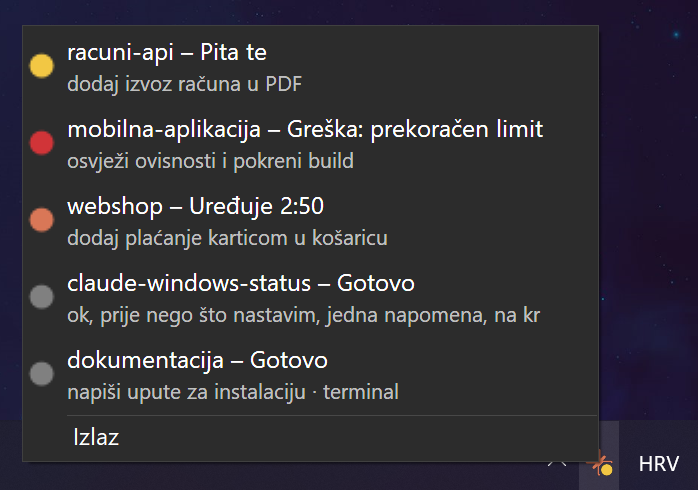
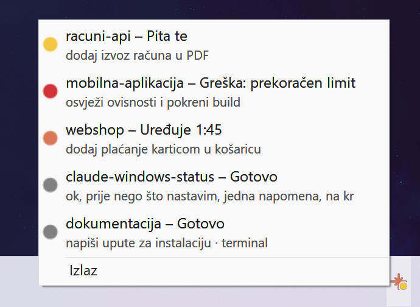
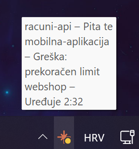
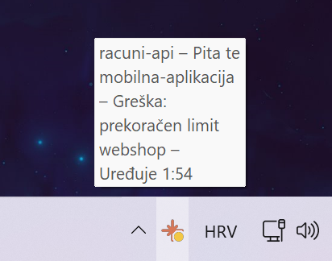

# ClaudeTray

Ikona u traci sustava za Windows 11 koja jednim pogledom pokazuje stanje svih Claude Code sesija na ovom PC-u: u VS Code ekstenziji i u terminalu (CLI). Klik na sesiju vodi ravno u nju. Ništa ne iskače: nema obavijesti, zvukova ni prozora koji se sami otvaraju.

Uzor je [m1ckc3s/claude-status-bar](https://github.com/m1ckc3s/claude-status-bar) za macOS. Dizajn je u [docs/superpowers/specs/2026-11-13-claude-tray-design.md](docs/superpowers/specs/2026-11-13-claude-tray-design.md).

| Tamna tema | Svijetla tema |
|---|---|
|  |  |
|  |  |

## Instalacija preko agenta

Najlakše je zamoliti svog agenta, na primjer Claude Code:

> Instaliraj ClaudeTray s https://github.com/shaxxx/ClaudeTray

Agent slijedi upute iz [AGENTS.md](AGENTS.md): provjeri preduvjete, preuzme gotovo izdanje i provjeri njegov SHA256, pita te prije izmjene `~/.claude/settings.json` i na kraju te uputi na jedini ručni korak, a to je jednom izvući ikonu iz `^` na traku. Ručni postupak opisan je niže.

## Što ikona znači

| Ikona | Stanje |
|---|---|
| bijela zvjezdica (crna na svijetloj traci) | sve sesije miruju ili su gotove |
| narančasta zvjezdica koja se vrti i pulsira | barem jedna sesija radi |
| narančasta zvjezdica sa žutom točkom | sesija te čeka: pitanje, plan ili dozvola |
| crvena zvjezdica | sesija je stala zbog greške (vrijedi do sljedećeg prompta u toj sesiji) |

Prioritet je: čeka te > greška > radi > potvrđena greška > gotovo/mirovanje. Potvrđena greška više ne boji ikonu, ali u izborniku ostaje crvena točka uz sesiju dok u njoj ne pošalješ novi prompt.

- **Tooltip** ima jedan red po sesiji: projekt i stanje, a dok sesija radi i trajanje.
- **Izbornik** (lijevi ili desni klik na ikonu) ima popis sesija i stavku „Izlaz".
- **Klik na sesiju** vodi u nju. Ako je sesija u grešci, klik ujedno potvrđuje grešku, pa ikona više ne pokazuje crvenu zbog nje.

| Sesija | Što klik radi |
|---|---|
| VS Code ekstenzija | dovodi pravi prozor VS Codea u prvi plan, pa otvara sesiju tamo gdje već jest (sidebar ili tab) |
| CLI u terminalu VS Codea | dovodi pravi prozor VS Codea u prvi plan |
| CLI u drugom terminalu (npr. Windows Terminal) | vraća i fokusira prozor terminala; tab se ne bira |

## Kako radi

- `claude-tray-hook.exe` (Native AOT, ~8 ms po pozivu) prijavljen je kao Claude Code hook. Za svaki događaj zapisuje stanje sesije u `%LOCALAPPDATA%\ClaudeTray\state\<session_id>.json`.
- Kad tray ne radi, hook ga pokreće.
- `ClaudeTray.exe` (WinForms) prati tu mapu i crta ikonu.
- Tray se sam gasi nekoliko sekundi nakon što nestane zadnja sesija.

## Gotovo izdanje

Na stranici [Releases](https://github.com/shaxxx/ClaudeTray/releases/latest) preuzmi `ClaudeTray-win-x64.zip` i raspakiraj ga bilo gdje. Jedini preduvjet je [.NET 10 Desktop Runtime](https://dotnet.microsoft.com/download/dotnet/10.0). Zatim u toj mapi pokreni:

```powershell
.\ClaudeTray.exe --install | Out-String
```

Exe nije digitalno potpisan, pa Windows SmartScreen pri prvom pokretanju preuzete datoteke može upozoriti („Windows je zaštitio vaše računalo"). Tada odaberi *Više informacija → Ipak pokreni*, ili prije pokretanja u PowerShellu upiši `Get-ChildItem | Unblock-File`. Kontrolni zbroj je u `ClaudeTray-win-x64.zip.sha256`.

Što instalacija radi i što slijedi nakon nje opisano je u odjeljku [Instalacija](#instalacija).

## Build

Za build iz izvornog koda potrebni su .NET SDK 10 i Visual Studio (ili Build Tools) s C++ alatima, za Native AOT.

```
git clone https://github.com/shaxxx/ClaudeTray.git
cd ClaudeTray
```

```
build.cmd
```

Skripta objavljuje oba exe-a u `artifacts\publish\`, pa pokreće testove. Testovi idu zadnji jer integracijski testovi pokreću objavljeni hook. Test brzine hooka samo upozorava, jer pod opterećenjem stroja zna biti nestabilan.

Ikona aplikacije `src\ClaudeTray\ClaudeTray.ico` (svijetla zvjezdica na narančastoj pločici) nalazi se u repozitoriju. Nakon promjene crteža generira se ponovno, pa se pokrene `build.cmd`:

```
artifacts\publish\ClaudeTray.exe --render-app-icon src\ClaudeTray\ClaudeTray.ico
```

## Instalacija

Iz mape gotovog izdanja pokreni `.\ClaudeTray.exe --install`, a nakon builda:

```powershell
artifacts\publish\ClaudeTray.exe --install | Out-String
```

`ClaudeTray.exe` je program s prozorom, pa ga PowerShell bez `| Out-String` (a cmd bez `| more`) ne čeka i ispis dolazi nakon prompta.

Instalacija:
1. ugasi tray ako radi;
2. kopira oba exe-a u `%LOCALAPPDATA%\Programs\ClaudeTray\`;
3. napravi sigurnosnu kopiju `~/.claude/settings.json` (`settings.json.bak-claudetray-<datum-vrijeme>`), odnosno `%CLAUDE_CONFIG_DIR%\settings.json` ako je ta varijabla postavljena;
4. doda 10 hookova i ne dira tuđe hookove ni ostale postavke.

Ponovno pokretanje je sigurno i služi i za nadogradnju. Ako `settings.json` nije ispravan JSON, instalacija javlja grešku i ništa ne mijenja. Komentari u `settings.json` ne preživljavaju zapis, ali ostaju u sigurnosnoj kopiji.

Sesije koje već rade učitavaju nove hookove od svog sljedećeg događaja, pa ih ne treba ponovno pokretati.

Kodovi izlaza su:
- `0`: u redu;
- `1`: neispravan `settings.json`;
- `2`: datoteka se ne može kopirati;
- `3`: nema izvornih datoteka;
- `4`: ostale greške.

### Jednokratni koraci nakon instalacije

- **Prikvačivanje ikone.** Windows novu ikonu skriva pod `^`. Povuci je iz `^` na traku ili uključi ClaudeTray u *Postavke → Personalizacija → Traka zadataka → Druge ikone u traci sustava*. Ikona se pojavljuje kad tray radi, odnosno kad postoji sesija.
- **Dijalog VS Codea.** Pri prvom kliku na VS Code sesiju VS Code pita „Allow 'Claude Code for VS Code' extension to open this URI?". Označi „Do not ask me again for this extension" i potvrdi. To je zaštita samog VS Codea, a ne prozor ClaudeTraya.

## Deinstalacija

```powershell
& "$env:LOCALAPPDATA\Programs\ClaudeTray\ClaudeTray.exe" --uninstall | Out-String
```

Deinstalacija:
- ugasi tray;
- napravi sigurnosnu kopiju `settings.json` i ukloni samo naše hookove (`"hooks"` ostaje, makar prazan);
- obriše naše datoteke u `%LOCALAPPDATA%\ClaudeTray\` i `%LOCALAPPDATA%\Programs\ClaudeTray\`. Mapa koja sadrži i tuđe datoteke ostaje.

## Izlaz

„Izlaz" u izborniku gasi tray i zapisuje `quit-intent`. Hook tada ne pokreće tray sve do sljedeće nove ili nastavljene sesije (`SessionStart`); sažimanje konteksta se ne računa.

## Dijagnostika

Postavi korisničku varijablu okruženja `CLAUDE_TRAY_DEBUG=1`, pa ponovno pokreni VS Code ili terminal. Tada:
- hook u `%LOCALAPPDATA%\ClaudeTray\hooks.log` zapisuje svaki primljeni događaj;
- tray u `tray.log` zapisuje pokretanje.

Neuhvaćene iznimke i ishod svakog klika na sesiju uvijek idu u `tray.log`, nikad u prozor.

Za testiranje se mape mogu preusmjeriti varijablama `CLAUDE_TRAY_HOME` (stanje i dnevnici) i `CLAUDE_TRAY_INSTALL_DIR` (programska mapa).

## Poznata ograničenja

- **Prikaz sesije u sidebaru** oslanja se na nevidencijarano ponašanje ekstenzije v2.1.323 (`open?session=` prikazuje sesiju koja je već u sidebaru). Nadogradnja ekstenzije to može promijeniti. U najgorem slučaju klik otvara sesiju u novom tabu.
- **Prekid tipkom Esc** prepoznaje se iz transkripta, čiji format nije dokumentiran.
- **CLI sesija:** fokusira se prozor terminala, ali ne i tab.
- **CLI u terminalu VS Codea:** prozor se traži po imenu mape u naslovu (mapa projekta ili neka njezina nadmapa). Kod istoimenih mapa (npr. više mapa `docs`) može doći pogrešan prozor.
- **Klik nikad ne otvara novi prozor VS Codea:** ako naslov nijednog prozora ne sadrži ime mape (npr. `.code-workspace`, prilagođeni `window.title`, VS Code pokrenut kao administrator), klik ne radi ništa.
- **Isti projekt u dva VS Code prozora:** samo fokus prozora, bez odabira sesije.
- **Alat koji radi dulje od 15 min** prikazuje se kao mirovanje.
- **Sesije otvorene prije instalacije** pojavljuju se tek nakon svog prvog sljedećeg događaja.
- **Potvrda greške** gubi se kad se tray ponovno pokrene.
- **Ikonu** treba jednom ručno izvući iz `^` na traku.
- **Dijalog VS Codea** za URI pojavljuje se jednom, dok ga se ne isključi (vidi gore).

## Ručna provjera

Sve stavke provjerene su za izdanje 1.0.0 (16. 11. 2026., Windows 11, 4K zaslon). Ishodi i greške nađene usput opisani su u Dodatku B [specifikacije](docs/superpowers/specs/2026-11-13-claude-tray-design.md). Prije nove verzije popis treba proći ponovno.

- [x] Ikone na tamnoj traci: mirovanje (bijela), radi (vrti se i pulsira), čeka te (žuta točka), greška (crvena).
- [x] Ikone na svijetloj traci: mirovanje je crna zvjezdica, ostale boje su iste.
- [x] Skaliranje 100 %, 150 % i 175 %: ikona je oštra i ispunjava mjesto u traci.
- [x] Smanjeni pokret (*Pristupačnost → Vizualni efekti → Efekti animacije* isključeni): ikona za rad stoji umjesto da se vrti.
- [x] Klik na sesiju u sidebaru VS Codea: pravi prozor dolazi u prvi plan, a sesija ostaje u sidebaru, bez novog taba.
- [x] Klik na sesiju u tabu VS Codea: pravi prozor i taj tab dolaze u prvi plan.
- [x] Klik na CLI sesiju u terminalu VS Codea: pravi prozor VS Codea dolazi u prvi plan.
- [x] Klik na CLI sesiju u Windows Terminalu (prozor minimiziran): prozor se vraća i dolazi u prvi plan.
- [x] Izlaz: tray nestaje i ne vraća se uz nove događaje postojećih sesija; nova sesija ga vraća.
- [x] Samogašenje: nakon zatvaranja svih sesija tray nestaje za nekoliko sekundi (provjereno s privremenom mapom stanja: 4 s nakon zadnje sesije).
- [x] Promjena teme dok tray radi: izbornik se pri sljedećem otvaranju prebaci na svijetle ili tamne boje.
- [x] Promjena skaliranja dok tray radi (npr. 175 % → 100 %): izbornik se otvara iznad ikone, a podnaslov je manji od glavnog retka i cijeli vidljiv.
- [x] Potvrda greške: klik na sesiju s greškom vraća ikonu u mirovanje, a crvena točka u izborniku ostaje do novog prompta.
- [x] Klik na sesiju čija mapa nije otvorena ni u jednom prozoru VS Codea: ništa se ne otvara.

## Licenca

[MIT](LICENSE). ClaudeTray nije povezan s Anthropicom; zvjezdica je generički crtež, a ne Claudeov logo.
